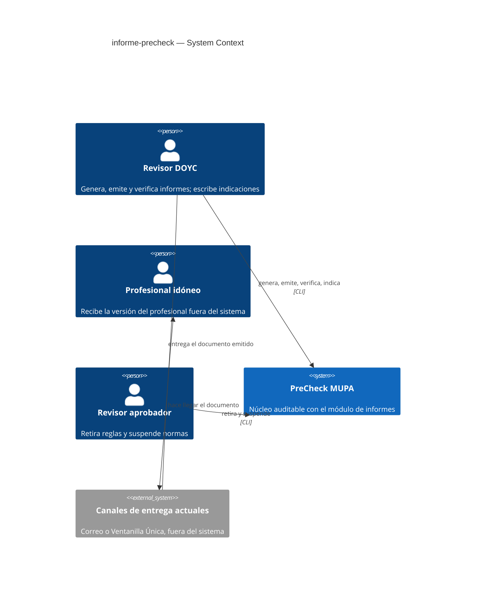
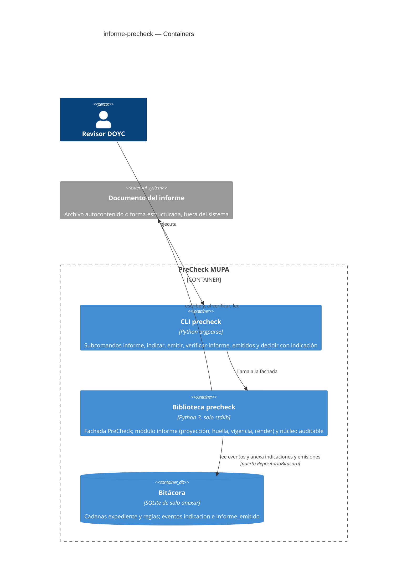
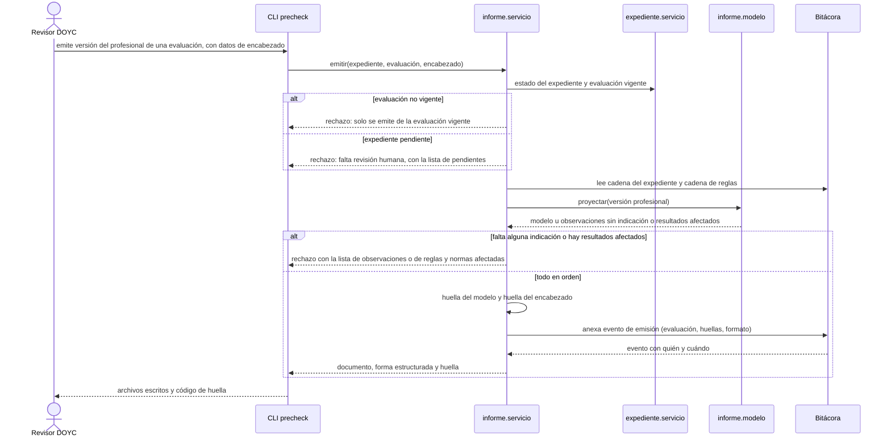
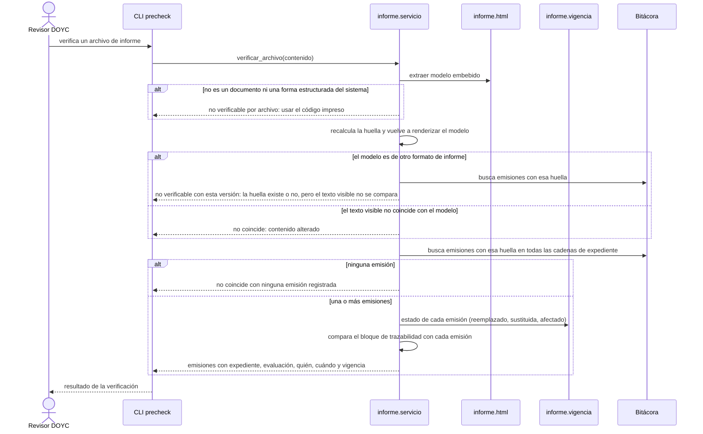
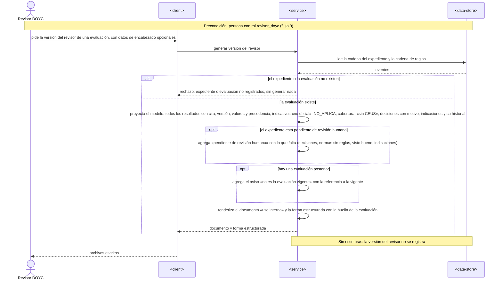
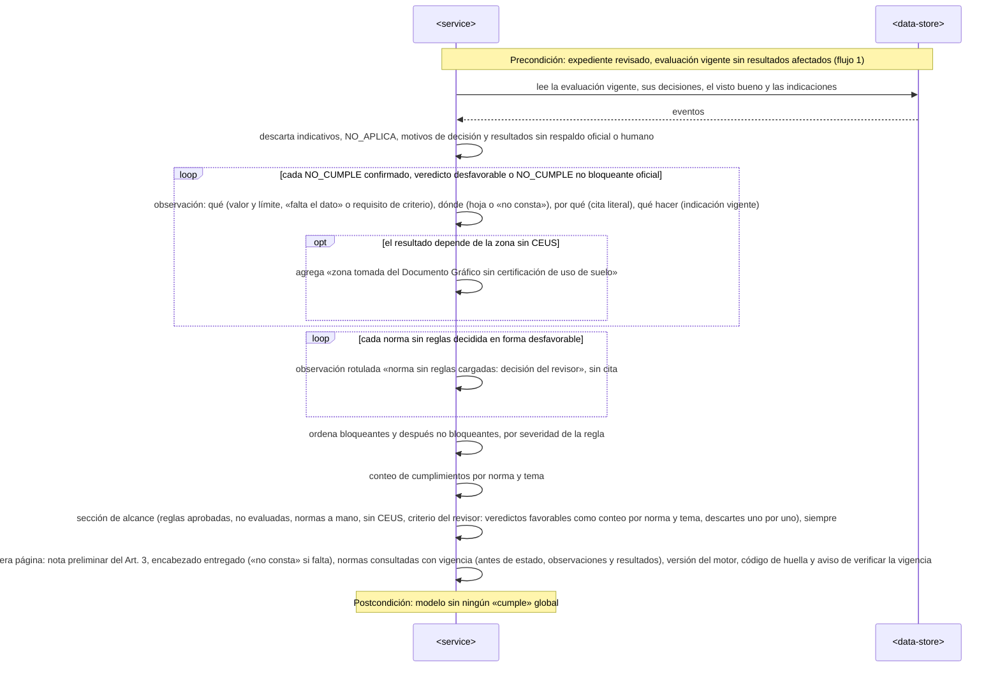
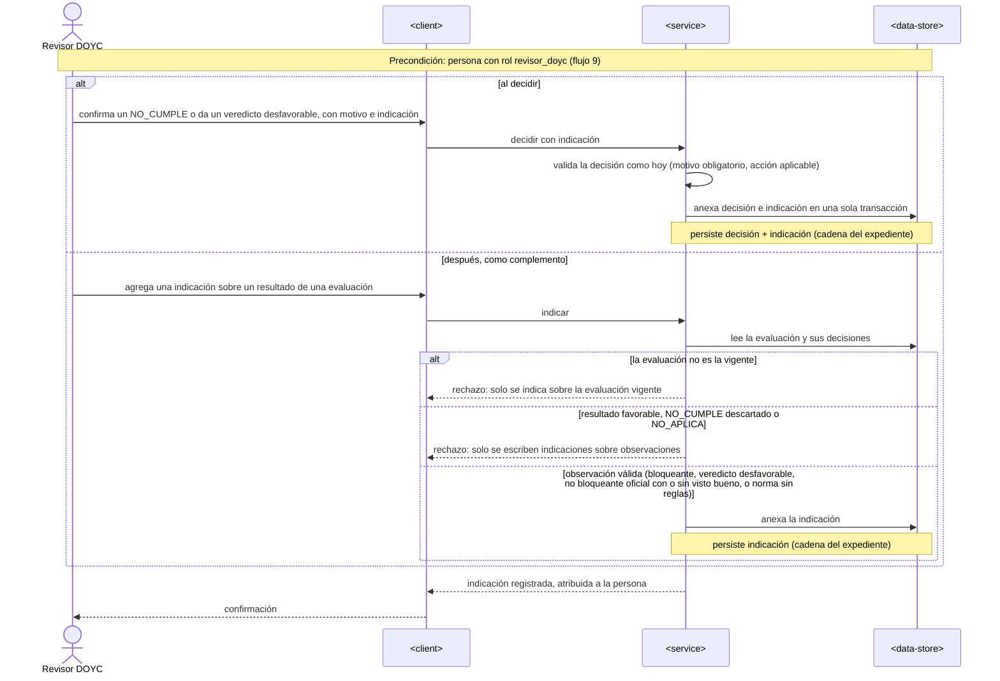
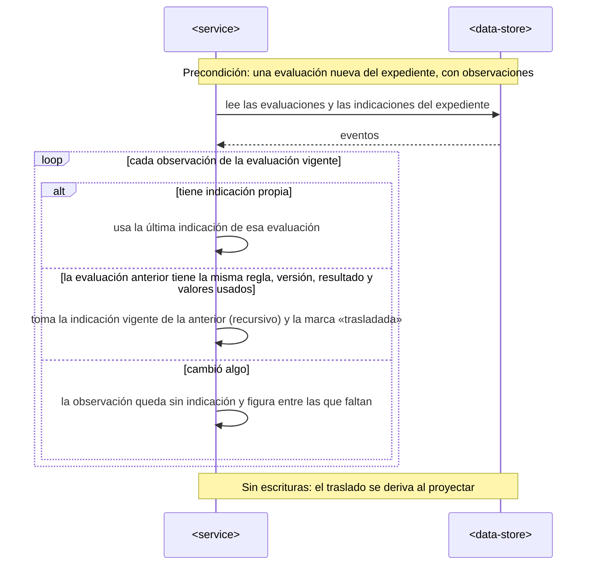
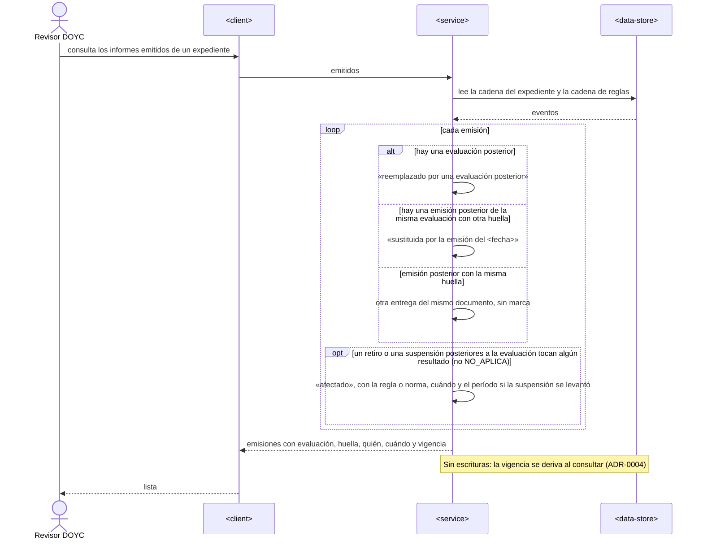
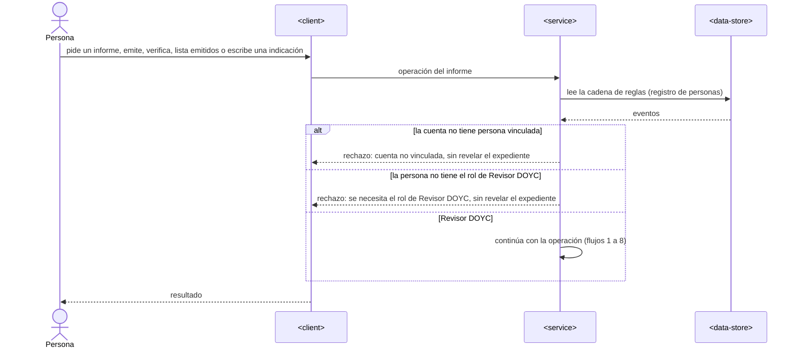

# Software Architecture Document — informe-precheck

## 1. Introduction and goals

**Intent.** Convertir cada evaluación registrada del PreCheck en un informe estandarizado en dos versiones. La versión del revisor es interna, completa y se regenera sin registrarse. La versión del profesional solo existe con el expediente revisado, contiene solo resultados oficiales o veredictos humanos redactados como observaciones con la indicación al profesional, declara siempre su alcance, y su emisión queda registrada con una huella verificable aun después de imprimirse (spec §1–§2).

**Top-3 quality goals (1-liners; full scenarios in §10):**

1. Nada sin respaldo llega al profesional: ni indicativos, ni resultados de una evaluación no vigente o afectada, ni observaciones sin indicación.
2. Verificabilidad: la huella de un informe emitido es reproducible y detecta cualquier alteración del contenido.
3. Trazabilidad sin copiar datos personales: el encabezado nunca entra en la bitácora; la emisión sí, con quién y cuándo.

**Stakeholders.**

| Role | Interest | Sign-off owner? |
|---|---|---|
| Revisor DOYC | Genera, emite y verifica informes; escribe indicaciones al profesional | No |
| Profesional idóneo | Recibe la versión del profesional (no opera el sistema) | No |
| Revisor aprobador | Sus retiros y suspensiones dejan informes afectados | No |
| DOYC | Membrete, nombre del revisor, tamaño de papel (spec §8) | No |
| Asesoría legal del MUPA | Texto de la nota preliminar; rectificación de datos | No |
| Tech Lead | Aprobación del SAD | Yes |
| Security Lead | Revisión de seguridad (spec §6.1: Required) | Yes |

<!-- Decision overrides (¶4) — populated by the critic resolution loop, empty otherwise. -->

## 2. Constraints

**Technical.**
- Python ≥ 3.11 (se ejecuta con 3.14); el núcleo usa solo la biblioteca estándar (`docs/architecture-map.md`). El informe no agrega dependencias: HTML con `html`/`string`, JSON con `json`, normalización con `unicodedata`.
- Bitácora SQLite de solo anexar detrás del puerto `RepositorioBitacora` (ADR-0002 de `motor-reglas-auditable`); sin migraciones nuevas: el informe agrega tipos de evento, no tablas.
- Arquitectura: biblioteca con fachada `PreCheck` y CLI delgada (ADR-0001 de `motor-reglas-auditable`); dominio puro + servicios que anexan eventos.

**Organisational.**
- Un desarrollador con Claude Code, flujo SDD con TDD; tamaño M (1–2 sprints). Sin fecha comprometida.

**Conventions.**
- `CLAUDE.md` (principios 1–5, español en documentos, mensajes y commits); `ruff` + `mypy` en `pyproject.toml`; pruebas `unittest` en `tests/`.
- Errores de negocio como `ErrorPreCheck(codigo)` traducidos por la CLI a salida 2; códigos con prefijo por dominio (`informe.*`).
- Serialización canónica y hash de `precheck/auditoria/canonico.py`.

**Regulatory / external.**
- Acuerdo 110, Art. 3: el informe es preliminar y no sustituye el dictamen de la DOYC; Arts. 43, 56, 68 y 81: no se agregan requisitos en la subsanación (motiva la sección de alcance).
- Datos del expediente solo por referencia en la bitácora (`motor-reglas-auditable` spec §6.1) → ADR-0005.

## 3. Context and scope

El informe lee la cadena del expediente (evaluaciones, decisiones, indicaciones, visto bueno, emisiones) y la cadena de reglas (estado, retiros, suspensiones) de la bitácora que ya existe, y produce un documento autocontenido y su forma estructurada. El Revisor DOYC lo genera, lo emite y lo verifica; el profesional idóneo solo recibe el archivo, fuera del sistema.

<!-- brownfield: núcleo auditable v0.1.0 — fachada precheck.PreCheck, servicios expediente/reglas/personas, bitácora SQLite con cadenas expediente:<id> y reglas (docs/architecture-map.md, reflects 30a8f82; desde entonces solo lint y motor.py) -->

**External systems (in / out):**

| Actor or system | Type | Interaction |
|---|---|---|
| Revisor DOYC | Person | Genera la versión del revisor, escribe indicaciones, emite la versión del profesional, verifica y lista emitidos |
| Profesional idóneo | Person (fuera del sistema) | Recibe el documento emitido por los canales actuales; lo imprime o convierte |
| Revisor aprobador | Person | Sus retiros y suspensiones (funcionalidad anterior) afectan informes emitidos |
| Bitácora (núcleo `motor-reglas-auditable`) | System (internal) | Fuente única de eventos; recibe los eventos `indicacion` e `informe_emitido` |
| Normativa cargada | System (internal) | La cita literal está en la instantánea de cada evaluación; la vigencia sale del contenido de cada versión de regla usada, direccionado por hash |

**C4 Context (L1):**



## 4. Solution strategy

**Target surfaces:** `library-sdk` + `cli`, igual que el núcleo (ADR-0001 de `motor-reglas-auditable`): toda la lógica en la biblioteca, la CLI solo traduce argumentos, salidas y códigos. Sin interfaz web: el documento generado es la «pantalla».

**Top strategic choices (the seeds for ADRs):**

1. **El informe es una proyección pura de la bitácora** — una función sin efectos arma el modelo del informe a partir de los eventos del expediente y del estado de las reglas; nada se guarda salvo el registro de la emisión. Cumple QG-2 (regenerar da lo mismo) sin hacer crecer la bitácora. → ADR-0001
2. **La huella es del contenido, no del archivo** — SHA-256 del JSON canónico del modelo (texto en NFC); el documento lleva el modelo embebido y la verificación lo recalcula y vuelve a renderizarlo para comparar. → ADR-0002
3. **La indicación al profesional es un evento propio** — separado de la decisión y de su motivo, anexado al decidir o después, para cualquier observación (bloqueante, no bloqueante o norma sin reglas). → ADR-0003
4. **La vigencia de un informe emitido se deriva al consultar** — reemplazado, sustituido y afectado salen de la cadena del expediente y de la cadena de reglas en el momento de verificar o listar; no se escriben marcas. → ADR-0004
5. **El encabezado nunca entra en la bitácora** — lo entrega el revisor al generar o emitir; la emisión guarda solo su huella. → ADR-0005

## 5. Building block view

Estilo hexagonal liviano, igual que el núcleo: dominio puro (modelo, huella, vigencia, render) sin E/S, un servicio de aplicación que resuelve la persona, lee la bitácora y anexa eventos, y la fachada/CLI como adaptadores. El render HTML es puro (modelo → texto) y reversible (texto → modelo) para la verificación.

**Internal decomposition:**

```
precheck/informe/
├── modelo.py       dominio: Informe, Encabezado, Observacion, Alcance, ResumenCumplimiento;
│                   proyectar(eventos_expediente, estado_reglas, evaluacion_seq, version, encabezado)
│                   con corte temporal para regenerar; aviso «no es la evaluación vigente» (AC-22);
│                   indicaciones vigentes con traslado entre evaluaciones (AC-24); FORMATO_INFORME
├── huella.py       dominio: normalización NFC + canónico → huella(modelo), huella_encabezado(enc), código en bloques
├── vigencia.py     dominio: estado de cada emisión (vigente / reemplazado / sustituida / afectado + períodos)
├── html.py         dominio: render(modelo, trazabilidad) → documento autocontenido; extraer(documento) → modelo
└── servicio.py     aplicación: generar, indicar, emitir, verificar_archivo, verificar_codigo, emitidos;
                    expediente o evaluación inexistentes → error (AC-03)
precheck/expediente/servicio.py   decidir(..., indicacion=None) anexa decisión + indicación en una transacción
precheck/auditoria/puertos.py     RepositorioBitacora gana anexar_lote(cadena_id, eventos) y cadenas()
precheck/auditoria/sqlite_repo.py anexar_lote — varios eventos en una transacción
precheck/contexto.py              anexar_lote con actor y reloj, como anexar
precheck/errores.py               códigos informe.*
precheck/__init__.py / cli.py     métodos y subcomandos nuevos: informe, indicar, emitir, verificar-informe, emitidos
```

**C4 Container (L2):**



## 6. Runtime view

Los participantes son los de §5. Flujos completos (autorización, indicar, traslado, verificar por código, listar emitidos) los agrega la etapa `sequences`.

**Critical flow 1: emitir la versión del profesional (US-02 · AC-04, AC-05, AC-06, AC-18, AC-20)**



**Critical flow 2: verificar un informe por archivo (US-05 · AC-12, AC-13)**



### Flujo 3: generar la versión del revisor (US-01 · AC-01, AC-02, AC-03, AC-22)



### Flujo 4: armar el contenido de la versión del profesional (US-03, US-04 · AC-08, AC-09, AC-10, AC-11, AC-19, AC-23)



### Flujo 5: escribir una indicación al profesional (US-07 · AC-17, AC-21)



### Flujo 6: trasladar indicaciones al reevaluar (US-07 · AC-24)



### Flujo 7: verificar por código impreso (US-05 · AC-12)

```mermaid
sequenceDiagram
    actor Revisor as Revisor DOYC
    participant client as <client>
    participant service as <service>
    participant store as <data-store>
    Revisor->>client: verifica una copia impresa con el expediente y el código de huella
    client->>service: verificar por código
    alt el código tiene menos de 16 caracteres
        service-->>client: rechazo: código demasiado corto
    else código válido
        service->>store: busca emisiones del expediente cuya huella empiece con el código
        store-->>service: emisiones
        alt ninguna emisión
            service-->>client: no coincide con ninguna emisión registrada
        else una o más emisiones
            service->>service: vigencia de cada emisión (flujo 8)
            alt el formato de la emisión no es el de esta versión
                service-->>client: la emisión existe, pero su contenido no es regenerable con esta versión
            else mismo formato
                service->>store: lee los eventos hasta la emisión y el estado de reglas a esa fecha
                service->>service: regenera el contenido emitido con «encabezado no conservado»
                service-->>client: emisiones con quién, cuándo y vigencia, contenido regenerado (código de la emisión y marca «regenerado para comparación») y aviso: el código prueba que la emisión existe, no que la copia esté íntegra; cuál es la emisión vigente
            end
        end
    end
    client-->>Revisor: resultado
```

### Flujo 8: listar los informes emitidos con su vigencia (US-06 · AC-14, AC-15, AC-16)



### Flujo 9: autorizar las operaciones del informe (US-01, US-02, US-05, US-06, US-07 · AC-07)



**Cobertura (sequences, 2026-09-27).**

| Historia | Flujos |
|---|---|
| US-01 | 3, 9 |
| US-02 | 1, 9 |
| US-03 | 4 |
| US-04 | 4 |
| US-05 | 2, 7, 9 |
| US-06 | 8, 9 |
| US-07 | 5, 6, 9 |

| AC | Dónde |
|---|---|
| AC-01, AC-02, AC-03, AC-22 | Flujo 3 |
| AC-04, AC-05, AC-06, AC-18, AC-20 | Flujo 1 |
| AC-07 | Flujo 9 |
| AC-08, AC-09, AC-10, AC-11, AC-19, AC-23 | Flujo 4 |
| AC-12 | Flujos 2 y 7 |
| AC-13 | Flujo 2 |
| AC-14, AC-15 | Flujo 8 |
| AC-16 | Flujo 1 (huella determinista) y flujo 8 (entregas y sustitución) |
| AC-17, AC-21 | Flujo 5 |
| AC-24 | Flujo 6 |

**Notas para data-model:** no hay entidades ni columnas nuevas; los eventos `indicacion` e `informe_emitido` viven en la tabla de eventos existente. Búsqueda por huella (flujos 2 y 7): recorrido de las cadenas de expediente; índice derivado solo si se supera el disparador de §7.

## 7. Deployment view

Sin cambios de despliegue: el módulo `informe` se distribuye dentro del mismo paquete Python y usa la misma bitácora SQLite de un solo escritor (sad de `motor-reglas-auditable` §7). Los archivos generados se escriben donde indique el revisor; el sistema no los conserva.

**Monitoring:**
- Emisiones rechazadas por motivo (pendiente, no vigente, sin indicación, afectada), como insumo del riesgo de carga del revisor.
- Verificaciones con resultado «no coincide» o «trazabilidad distinta»: alerta al Security Lead si hay alguna.

**Scaling thresholds:**
- Verificar busca en todas las cadenas de expediente. La escala cómoda de SQLite (decenas de miles de expedientes al año) viene del sad de `motor-reglas-auditable` §7; el límite es el NFR de la spec §6 («≤ 2 s p95 por operación»). Disparador interno, no NFR: si una verificación supera 1 s en la suite, se agrega un índice por huella (tabla derivada, reconstruible) sin cambiar la bitácora.

## 8. Crosscutting concepts

| Concept | Convention | Where defined |
|---|---|---|
| Identidad y autorización | Toda operación del informe exige el rol `revisor_doyc` (mismo `exigir_revisor` de `expediente.servicio`; los predicados de observaciones e indicaciones están en `expediente.observaciones`, compartidos con el núcleo); la persona la resuelve el núcleo | ADR-0006 de `motor-reglas-auditable` |
| Contenido con huella | Modelo del informe → normalización NFC de todo texto, recorte de espacios en los datos de encabezado → `canonico()` → SHA-256. Fuera de la huella: bloque de trazabilidad (quién emitió, cuándo) y la huella misma | ADR-0002 |
| Versión del formato | `FORMATO_INFORME` (semver) dentro del modelo y en el evento de emisión; un cambio en la proyección que altere el modelo sube la versión; regenerar por código o comparar el documento completo exige la misma versión: si la huella solo corresponde a emisiones de otro formato responde «no verificable con esta versión» (salida 5, como `NO_REPRODUCIBLE`); si no corresponde a ninguna, «no coincide» (salida 3) | ADR-0002 |
| Código impreso | Huella hex completa en bloques de 4 caracteres + id del expediente, en el pie de cada página; la búsqueda por código acepta ≥ 16 caracteres iniciales dentro del expediente | aquí (spec AC-12) |
| Eventos nuevos | `indicacion` {evaluacion_seq, hash_evaluacion, regla_id (o `norma:X`), texto}; `informe_emitido` {evaluacion_seq, hash_evaluacion, version: "profesional", huella, huella_encabezado, formato_informe, version_motor}. Ambos en la cadena `expediente:<id>`; el sobre aporta actor y fecha | ADR-0003, ADR-0005 |
| Indicación vigente | Por observación: la última `indicacion` sobre esa evaluación; si no hay, la de la evaluación anterior si la regla tiene la misma versión, resultado y valores usados (traslado recursivo, marcado como trasladado) | ADR-0003 |
| Vigencia de emisiones | Derivada al consultar: reemplazado si hay una evaluación posterior; sustituida si hay otra emisión posterior de la misma evaluación con otra huella; afectado si un retiro o una suspensión confirmada (no levantada) que la instantánea de la evaluación de origen no reflejaba (su `estado_regla` no era ya `retirada` o `suspendida`) tocan algún resultado no NO_APLICA de ella (norma por `linaje`), con períodos por levantamiento; por emisión se omiten los períodos cerrados antes de emitirla | ADR-0004 |
| Corte temporal | Regenerar una emisión usa los eventos del expediente hasta su `seq` y `estado_reglas(en=ocurrido_en)` de la emisión | ADR-0001 |
| Salida HTML | Documento autocontenido, sin scripts ejecutables ni recursos externos; estilos de impresión carta y legal; todo texto escapado; el modelo va en un bloque de datos no ejecutable; estados siempre en texto | ADR-0002, spec §6 |
| Errores | `ErrorPreCheck` con códigos `informe.*` (p. ej. pendiente, no vigente, sin indicación, afectada, expediente o evaluación inexistentes, con mensajes que nombran expediente, evaluación y vigente) → salida 2; verificación sin coincidencia → salida 3, igual que `verificar`; formato de otra versión → salida 5 | `precheck/errores.py`, contrato CLI |
| Transacciones | `anexar_lote` en el repositorio: decisión + indicación en una sola transacción. `emitir` toma las cabezas de la cadena del expediente y de la de reglas antes de validar y `anexar(..., cabezas=...)` las comprueba dentro de la misma transacción exclusiva (`BEGIN IMMEDIATE`): si avanzaron, no registra (`informe.emision_concurrente`). La CLI valida el directorio de salida antes de emitir y escribe con temporal + `os.replace` (salida 7 si la emisión quedó registrada sin archivos) | puerto `RepositorioBitacora`, contrato CLI |
| Internationalisation | N/A: solo español | — |

## 9. Architecture decisions

| # | Title | Status | Section |
|---|---|---|---|
| 0001 | Construir el informe como proyección pura de la bitácora | Accepted | §4 |
| 0002 | Calcular la huella sobre el JSON canónico del modelo embebido en el documento | Accepted | §4, §8 |
| 0003 | Registrar la indicación al profesional como evento propio | Accepted | §4, §8 |
| 0004 | Derivar la vigencia de los informes emitidos al consultar | Accepted | §4, §8 |
| 0005 | Mantener el encabezado fuera de la bitácora y guardar solo su huella | Accepted | §4, §2 |

ADR files live under `docs/features/informe-precheck/adr/NNNN-<title>.md`.

## 10. Quality requirements

**QG-1. Nada sin respaldo llega al profesional**
- **When:** se intenta emitir la versión del profesional con el expediente pendiente, desde una evaluación no vigente, con observaciones sin indicación o con resultados afectados.
- **Then:** no se emite; «Informes emitidos con resultados sin respaldo oficial o humano — target: 0 en todo momento» (spec §7).
- **How verify:** pruebas de cada rechazo (AC-05, AC-06, AC-18, AC-20) y prueba de que el modelo profesional no contiene indicativos ni NO_APLICA (AC-09).

**QG-2. Verificabilidad**
- **When:** se regenera o se verifica un informe emitido, o se altera su contenido.
- **Then:** «100 % de regeneraciones de la misma evaluación con las mismas decisiones, indicaciones y datos de encabezado producen la misma huella»; «100 % de archivos originales (documento o forma estructurada) con un solo carácter de contenido alterado se reportan como no coincidentes; 0 falsos rechazos del mismo contenido en su otra forma original» (spec §6); KPI «Informes emitidos verificables contra la bitácora — target: 100 % desde el primer informe emitido» y «Observaciones completas en la versión del profesional … target: 100 % desde el primer informe emitido» (spec §7).
- **How verify:** prueba automática que regenera y compara; prueba de manipulación carácter a carácter sobre el documento y sobre la forma estructurada.

**QG-3. Rendimiento y autocontenido**
- **When:** se genera, emite o verifica con el catálogo completo.
- **Then:** «≤ 2 s p95 por operación … con el catálogo completo (~650 resultados)»; «0 referencias a recursos externos en el documento; se abre y se imprime sin red»; «100 % de estados (CUMPLE, NO_CUMPLE, REQUIERE_REVISION, no oficial) expresados en texto, no solo con color; impresión en carta y legal sin cortar tablas» (spec §6).
- **How verify:** medición en la suite con `tests/casos/`; inspección automática del documento (sin `src`/`href` externos ni scripts ejecutables); revisión manual de impresión.

## 11. Risks and technical debt

| Risk / debt | Severity | Mitigation | Owner |
|---|---|---|---|
| El HTML visible se edita sin tocar el modelo embebido y la verificación por archivo no lo nota | Medium | La verificación vuelve a renderizar el modelo y compara el texto visible (ADR-0002) | Tech Lead |
| Un cambio en la proyección impide regenerar un informe viejo por código | Medium | `FORMATO_INFORME` en cada emisión; «no regenerable con esta versión» en vez de una comparación falsa; conservar formatos igual que las versiones del motor | Tech Lead |
| Verificar recorre todas las cadenas de expediente | Low | Umbral de §7 y un índice derivado por huella si hace falta | Tech Lead |
| El código impreso prueba que la emisión existe, no que la copia esté íntegra | Low | Regenerar el contenido emitido para comparación manual (AC-12); aceptado en la spec | Security Lead |
| Regenerar por código no reproduce el encabezado (no se guarda) | Low | Aceptado (ADR-0005): se muestra «encabezado no conservado» y su huella | Tech Lead |
| Open question: nombre del Revisor DOYC en la versión del profesional | Open question | Default: identificador y nombre en el bloque de trazabilidad, fuera de la huella. Due original de spec §8: before sdd:design, movido aquí (el default no cambia la arquitectura) | DOYC — before sdd:tasks |
| Open question: identidad institucional (membrete) | Open question | Default: sin marca institucional. Due original de spec §8: before sdd:design, movido aquí (solo afecta la plantilla) | DOYC — before sdd:tasks |
| Open question: texto exacto de la nota preliminar | Open question | Default: texto del skill `mupa-informe-precheck` + aclaración del dictamen | Asesoría legal del MUPA — before sdd:tasks |
| Open question: rectificar un dato del encabezado ya emitido | Open question | Default: emitir de nuevo; la anterior queda sustituida (el default de spec §8 decía «reemplazado»; se usa «sustituida» por la distinción de AC-15 y `CONTEXT.md`) | Asesoría legal del MUPA — before sdd:data-model |
| Open question: tamaño de papel oficial | Open question | Default: carta, con estilos que imprimen en legal | DOYC — before sdd:tasks |

**Accepted debt (acceptable in v1, plan to fix later):**
- La verificación la hace solo un Revisor DOYC; la verificación pública llega con la API autenticada.
- Sin PDF propio: el profesional imprime o convierte, y esas copias se verifican por código.

## 12. Glossary

| Term | Meaning |
|---|---|
| Informe PreCheck, versión del revisor, versión del profesional, observación, indicación al profesional, informe emitido | Ver `CONTEXT.md` |
| Evaluación vigente, informe afectado, informe reemplazado, emisión sustituida | Ver `CONTEXT.md` |
| Modelo del informe | Estructura de datos que contiene todo lo que el informe dice; de ella salen el documento y la forma estructurada, y sobre ella se calcula la huella |
| Bloque de trazabilidad | Parte del documento con quién emitió y cuándo; se imprime pero queda fuera de la huella y se compara con el evento de emisión |
| `FORMATO_INFORME` | Versión de la proyección que produce el modelo |
