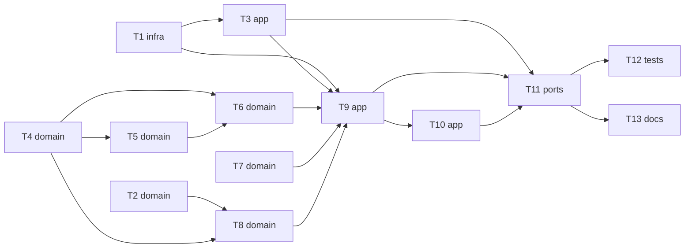

# Epic — informe-precheck

> **Spec:** [spec.md](../spec.md) · **Design:** [sad.md](../sad.md) · **Data model:** no aplica (omisión legal: sin cambio de esquema, ver [api-sync-report.md](../contracts/api-sync-report.md)) · **Contratos:** [cli.md](../contracts/cli.md), [public-api.md](../contracts/public-api.md) · **ADRs:** [adr/](../adr/)

## Goal

Convertir cada evaluación registrada en un informe estandarizado en dos versiones: la del revisor, interna y completa, que sirve para decidir aun sin reglas aprobadas; y la del profesional, que solo se emite con el expediente revisado, lleva observaciones accionables con respaldo oficial o humano, declara su alcance y queda registrada con una huella verificable contra la bitácora, con su vigencia consultable (spec §2).

## Scope

- **In:** puerto de bitácora (`anexar_lote`, `cadenas`) y códigos `informe.*`; dominio `precheck/informe/` (modelo, huella, vigencia, html); servicio del informe y `decidir --indicacion`; fachada `PreCheck` y CLI; pruebas de extremo a extremo y NFR; documentación.
- **Out:** entrega por portal o Ventanilla Única, PDF generado por el sistema, miniaturas del plano, redacción automática del «qué hacer», verificación pública por terceros (spec §3). Sin migraciones ni interfaz web (`target_surfaces: [library-sdk, cli]`).

## Task map

Ramas paralelas: la ola 1 (T1, T2, T4, T7) arranca a la vez; en la ola 2 corren T3, T5 y T8; en la ola 7, T12 y T13.

## Tasks

See [tracker.md](./tracker.md) for status. Machine contract: [tasks.json](../tasks.json).

| # | Task | Layer | Blocked by | DoD (short) |
|---|---|---|---|---|
| T1 | [Agregar anexar_lote y cadenas al puerto de bitácora y los códigos informe.*](./puerto-anexar-lote-y-errores.md) | infra | — | `tests/test_anexar_lote.py` pasa; 7 códigos `informe.*` en `CODIGOS` |
| T2 | [Calcular la huella del modelo y el código impreso en bloques](./huella-y-codigo.md) | domain | — | `tests/test_informe_huella.py` pasa (NFC, espacios, prefijo ≥ 16) |
| T3 | [Registrar la indicación al profesional y decidir con indicación](./indicar-y-decidir-con-indicacion.md) | app | T1 | `tests/test_informe_indicar.py` cubre AC-17 y AC-21 y pasa |
| T4 | [Proyectar el modelo de la versión del revisor con corte temporal](./modelo-version-revisor.md) | domain | — | `tests/test_informe_modelo_revisor.py` cubre AC-01, AC-02 y AC-22 y pasa |
| T5 | [Derivar la indicación vigente y su traslado entre evaluaciones](./indicaciones-vigentes-y-traslado.md) | domain | T4 | `tests/test_informe_traslado.py` cubre AC-24 y pasa |
| T6 | [Proyectar la versión del profesional con observaciones, alcance y primera página](./modelo-version-profesional.md) | domain | T4, T5 | `tests/test_informe_modelo_profesional.py` cubre AC-08–11, AC-19 y AC-23 y pasa |
| T7 | [Derivar la vigencia de las emisiones y los resultados afectados](./vigencia-de-emisiones.md) | domain | — | `tests/test_informe_vigencia.py` cubre AC-14, AC-15, AC-16 y AC-20 y pasa |
| T8 | [Renderizar el documento autocontenido y extraer su modelo](./render-html-y-extraccion.md) | domain | T2, T4 | `tests/test_informe_html.py` pasa (autocontenido, escape, ida y vuelta) |
| T9 | [Generar la versión del revisor y emitir la del profesional](./generar-y-emitir.md) | app | T1, T3, T6, T7, T8 | `tests/test_informe_emitir.py` cubre AC-01, 03–06, 16, 18 y 20 y pasa |
| T10 | [Verificar informes por archivo y por código y listar emitidos](./verificar-y-emitidos.md) | app | T9 | `tests/test_informe_verificar.py` cubre AC-12 a AC-15 y pasa |
| T11 | [Exponer los métodos del informe en la fachada y la CLI](./fachada-y-cli.md) | ports | T3, T9, T10 | `tests/test_cli_informe.py` cubre AC-07 y las salidas del contrato y pasa |
| T12 | [Agregar la prueba de extremo a extremo y las de NFR del informe](./extremo-a-extremo-y-nfr.md) | tests | T11 | Ciclo completo y NFR de spec §6 en verde |
| T13 | [Documentar el módulo informe y registrar el cambio](./documentacion-y-changelog.md) | docs | T11 | README, CHANGELOG, architecture-map y CLAUDE.md actualizados |

## Risks / Hard rules

- Nada sin respaldo llega al profesional: ni indicativos, ni resultados de una evaluación no vigente o afectada, ni observaciones sin indicación. — `sad.md §1, QG-1`
- El encabezado nunca entra en la bitácora; la emisión guarda solo `huella_encabezado`. — ADR-0005, `sad.md §2`
- Sin migraciones: el informe agrega tipos de evento (`indicacion`, `informe_emitido`), no tablas; la bitácora es de solo anexar. — `sad.md §2`
- El motivo de la decisión nunca sale del sistema; todo texto se muestra como texto plano; el informe nunca presenta el expediente como aprobado ni declara un «cumple» global. — `spec.md §6.1`, AC-11, AC-19
- Toda operación del informe exige el rol `revisor_doyc`, sin revelar el expediente a quien no lo tiene. — `sad.md §8`, AC-07
- Preguntas abiertas con due «before sdd:tasks» que siguen abiertas (texto de la nota preliminar, nombre del revisor en la trazabilidad, membrete, tamaño de papel): las tareas usan sus defaults de `spec.md §8` / `sad.md §11`, y T13 las deja señaladas en el README.
