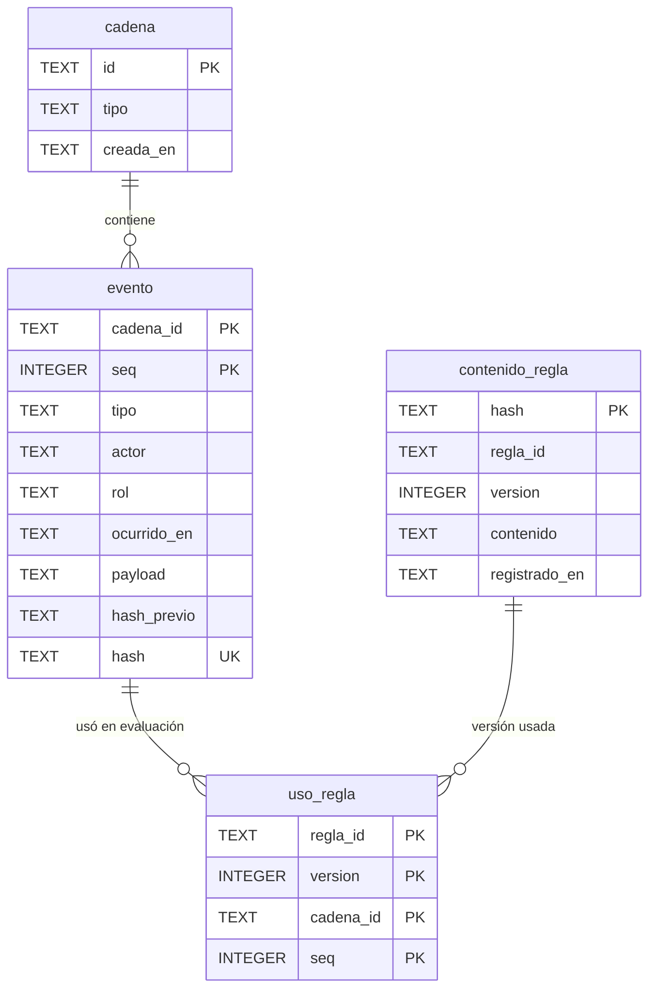

# Data model — motor-reglas-auditable

Motor: SQLite 3.46 (biblioteca estándar de Python), tablas `STRICT`, `PRAGMA foreign_keys = ON` en cada conexión (ADR-0002). La bitácora es de solo anexar: triggers `BEFORE UPDATE/DELETE` abortan cualquier modificación y un trigger `BEFORE INSERT` exige que cada evento continúe su cadena. Personas, estado de reglas y estado del expediente **no son tablas**: se derivan leyendo eventos (ADR-0005, ADR-0006). La CEUS, los datos declarados y la fecha de presentación llegan en los hechos del expediente y quedan dentro de la instantánea del evento de evaluación.

## ER diagram

## Entities

### `cadena` (raíz)

| Column | Type | Constraints | Notes |
|---|---|---|---|
| `id` | TEXT | PK | `reglas` o `expediente:<expediente_id>` |
| `tipo` | TEXT | NOT NULL, CHECK en (`reglas`, `expediente`), coherente con `id` | |
| `creada_en` | TEXT | NOT NULL | ISO 8601 UTC |

**Aggregate root:** raíz. **Access patterns:** lectura por `id` → PK. **Constraints:** sin UPDATE ni DELETE (triggers). Bootstrap: la fila `reglas` se crea en la migración 01.

### `evento`

| Column | Type | Constraints | Notes |
|---|---|---|---|
| `cadena_id` | TEXT | PK, FK → `cadena(id)` | |
| `seq` | INTEGER | PK, CHECK ≥ 1; trigger: = máximo de la cadena + 1 | orden dentro de la cadena |
| `tipo` | TEXT | NOT NULL | ver «Tipos de evento»; se valida en la aplicación para no congelar el conjunto en un CHECK |
| `actor` | TEXT | NOT NULL | `persona_id` del registro, o `sistema:precheck@<version>` para el sello programado |
| `rol` | TEXT | NOT NULL | rol con el que actuó |
| `ocurrido_en` | TEXT | NOT NULL | ISO 8601 UTC |
| `payload` | TEXT | NOT NULL, CHECK `json_valid` | JSON canónico (sad §8) |
| `hash_previo` | TEXT | NOT NULL; `''` si y solo si `seq = 1`; trigger: = hash del evento anterior | |
| `hash` | TEXT | NOT NULL, UNIQUE, largo 64 | `sha256(hash_previo + canónico({cadena_id, tipo, actor, rol, ocurrido_en, payload}))`, calculado por la aplicación |

**Aggregate root:** `cadena`. **Access patterns:** leer una cadena en orden y su cabeza → PK `(cadena_id, seq)`; ubicar un evento por el hash sellado → UNIQUE `hash`. **Constraints:** continuidad, no UPDATE, no DELETE (triggers).

**Tipos de evento** (validados por el núcleo):
- Cadena de expediente: `evaluacion`, `decision`, `visto_bueno`, `reproduccion`, `afectado_suspension`, `anulacion`.
- Cadena de reglas: `propuesta`, `aprobacion`, `rechazo`, `retiro`, `suspension_propuesta`, `suspension_confirmada`, `levantamiento_propuesto`, `levantamiento_confirmado`, `designacion_genesis`, `designacion_propuesta`, `designacion_confirmada`, `vinculo_propuesto`, `vinculo_confirmado`, `sello`.

El payload de `evaluacion` guarda la instantánea (ADR-0004): fecha de presentación, hechos con su fuente, umbral, `VERSION_MOTOR` y commit, y por cada regla `(regla_id, version, hash_contenido, estado_a_la_evaluacion, resultado, indicativo, motivo, valores_usados)`, más la cobertura. El contenido de cada regla se referencia por `hash_contenido` en `contenido_regla`.

### `contenido_regla`

| Column | Type | Constraints | Notes |
|---|---|---|---|
| `hash` | TEXT | PK, largo 64 | `sha256(canónico(contenido))`; se autoverifica |
| `regla_id` | TEXT | NOT NULL | `<NORMA>-<TRAMITE>-<TEMA>` |
| `version` | INTEGER | NOT NULL, CHECK ≥ 1 | |
| `contenido` | TEXT | NOT NULL, CHECK `json_valid` | la versión completa, según el esquema de reglas |
| `registrado_en` | TEXT | NOT NULL | ISO 8601 UTC |

**Aggregate root:** raíz de contenido (lo referencian `propuesta` y `evaluacion` por hash). **Access patterns:** cargar por hash → PK; cargar por `(regla_id, version)` → UNIQUE. **Constraints:** una sola versión por `(regla_id, version)`; inmutable (triggers).

### `uso_regla` (índice de uso, reconstruible)

| Column | Type | Constraints | Notes |
|---|---|---|---|
| `regla_id` | TEXT | PK, FK → `contenido_regla(regla_id, version)` | |
| `version` | INTEGER | PK | |
| `cadena_id` | TEXT | PK, FK → `evento(cadena_id, seq)` | |
| `seq` | INTEGER | PK | |

**Aggregate root:** `evento` (se escribe en la misma transacción que el evento de evaluación). **Access patterns:** qué evaluaciones usaron una versión (flujos 5 y 6) → PK; FK hacia el evento → `idx_uso_regla_evento`. **Constraints:** de solo anexar (triggers).

## Indexes

| Index | Columns | Query it serves |
|---|---|---|
| PK `cadena` | `id` | Todos los flujos: abrir la cadena del expediente o la de reglas |
| PK `evento` | `cadena_id, seq` | Flujos 1, 2, 9, 10: leer una cadena en orden, obtener la cabeza, verificar la continuidad |
| UNIQUE `evento.hash` | `hash` | Flujo 10: ubicar el evento de una cabeza sellada |
| PK `contenido_regla` | `hash` | Flujos 1 y 9: cargar el contenido referenciado por la instantánea |
| UNIQUE `contenido_regla` | `regla_id, version` | Flujos 4 y 5: la versión existe o no, y cuál es el siguiente número |
| PK `uso_regla` | `regla_id, version, cadena_id, seq` | Flujos 5 y 6: evaluaciones que usaron una versión retirada o suspendida |
| `idx_uso_regla_evento` | `cadena_id, seq` | Índice de la FK hacia `evento` |

## Test fixtures

Fixtures en la forma que usa el repo (funciones en `tests/`, con `unittest`), no en migraciones:

- `bitacora_en_memoria()`: conexión SQLite `:memory:` con las migraciones aplicadas y `foreign_keys = ON`.
- `persona(id="P-0001", nombre="Test User", correo="user-0001@example.test", roles=[...])`: persona del registro.
- `regla(id="A110-TEST-X", version=1, estado="borrador", ...)`: contenido de regla con una cita que exista en la normativa.
- `expediente(id="EXP-TEST-0001", fecha_presentacion="2025-06-01", hechos={...})`: a partir de `tests/casos/*.json`.
