# Software Architecture Document — motor-reglas-auditable

## 1. Introduction and goals

**Intent.** Convertir el motor de reglas del PreCheck MUPA en un núcleo auditable para el Revisor DOYC. Ningún resultado oficial sale de una regla no aprobada con cuatro ojos. Cada evaluación, aprobación y decisión humana queda en una bitácora encadenada, atribuida a una persona y reproducible. El expediente solo pasa a «revisado» con la firma humana, nunca a «aprobado», porque el dictamen es de la DOYC (Acuerdo 110, Art. 3).

**Top-3 quality goals (1-liners; full scenarios in §10):**

1. **Reproducibilidad**: toda evaluación registrada se vuelve a ejecutar con el mismo resultado.
2. **Integridad verificable**: toda alteración de la bitácora anterior al último anclaje es detectable.
3. **Corrección conservadora**: cero falsos CUMPLE; ante la duda, REQUIERE_REVISION.

**Stakeholders.**

| Role | Interest | Sign-off owner? |
|---|---|---|
| Revisor DOYC | Evaluar expedientes, decidir, reproducir y verificar | No |
| Revisor aprobador | Aprobar, rechazar, retirar y suspender reglas | No |
| Redactor de reglas | Proponer versiones con cita literal | No |
| Tech Lead | Aprobar el SAD | Yes |
| Security Lead | Revisión de seguridad (spec §6.1: Required) | Yes |

## 2. Constraints

**Technical.**
- Python 3 (`docs/architecture-map.md`). El núcleo usa solo la biblioteca estándar (`precheck/motor/motor.py:8-15`); las dependencias de `requirements.txt` quedan en los módulos de extracción.
- Evaluador de expresiones con AST restringido y gramática cerrada (`docs/contexto/esquema-reglas.md`); no se amplía en esta funcionalidad.
- Catálogos de reglas en `reglas/*.json`: 648 reglas, todas en borrador y con cita verificada.
- Canónico JSON ya usado para hashes: `sort_keys`, `ensure_ascii=False`, separadores compactos (`precheck/auditoria/verificar_cadena.py:13`).

**Override de convenciones del repo.** Este diseño se aparta de tres patrones del mapa de arquitectura: scripts sin importaciones entre módulos (el núcleo pasa a ser una biblioteca, ADR-0001), datos solo en JSON (la bitácora pasa a SQLite, ADR-0002) y pruebas solo por subproceso (el núcleo se prueba en proceso; los scripts existentes conservan sus pruebas por subproceso). Ver §11.

**Organisational.**
- Tamaño M, entre 1 y 2 sprints; equipo pequeño.
- No hay revisor aprobador designado todavía (spec §8).

**Conventions.**
- `CLAUDE.md`: principios 1 a 5, idioma español en código, mensajes y commits.
- Pruebas con `unittest` (`python3 -m unittest discover -s tests -v`) y casos JSON en `tests/casos/`.
- IDs de regla `<NORMA>-<TRAMITE>-<TEMA>` con `version` entera no reutilizable.

**Regulatory / external.**
- Acuerdo 110, Art. 3: el PreCheck es preliminar y no sustituye el dictamen.
- Riesgo de nulidad del PLOT (Acuerdo 61) ante la CSJ: exige poder suspender en bloque (ADR-0008).
- Datos personales: la bitácora guarda identificadores de personas y referencias a expedientes, no copia datos del propietario (spec §6.1).

## 3. Context and scope

El PreCheck recibe de un expediente los datos declarados, la zona que da el GIS, la CEUS (si existe) y la fecha de presentación, y los evalúa contra el catálogo de reglas. El Revisor DOYC decide sobre los resultados. El gobierno de reglas (proponer, aprobar, suspender) es un circuito aparte con sus propios actores.

<!-- brownfield: scripts CLI autónomos (motor, citas, cadena, cad/bim/gis) que se comunican por JSON; no hay bitácora persistente ni flujo de aprobación (docs/architecture-map.md, reflects 2d22abe) -->

**External systems (in / out):**

| Actor or system | Type | Interaction |
|---|---|---|
| Revisor DOYC | Person | Evalúa, decide, da visto bueno, reproduce y verifica |
| Redactor de reglas | Person | Propone versiones de reglas |
| Revisor aprobador | Person | Aprueba, rechaza, retira y suspende reglas |
| Normativa cargada (`normativa/`) | System (internal) | Fuente para verificar las citas literales |
| Extracción y GIS (`precheck/cad`, `bim`, `gis`) | System (internal) | Produce hechos; fuera del alcance, solo es insumo |
| Destino de anclaje | System (external, otra unidad) | Recibe el sello diario de las cabezas de cadena |

**C4 Context (L1):**

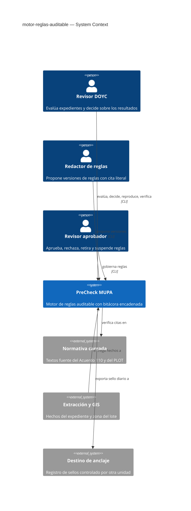

## 4. Solution strategy

**Top strategic choices (the seeds for ADRs):**

1. **Núcleo como biblioteca con CLI delgada** (`target_surfaces: [cli, library-sdk]`). La lógica de evaluar, gobernar, decidir, reproducir y verificar vive en funciones importables y sin E/S de consola; la CLI solo traduce argumentos. La futura API y la cola reutilizan el núcleo. → ADR-0001
2. **Bitácora de solo anexar en SQLite tras un puerto.** Viene en la biblioteca estándar, da escrituras atómicas y triggers que prohíben modificar o borrar; el puerto permite migrar a PostgreSQL con la API. → ADR-0002
3. **Dos familias de cadenas y sello conjunto.** Una cadena por expediente y una cadena de reglas; el sello diario combina todas las cabezas en un hash que se exporta fuera del sistema. → ADR-0003, ADR-0007
4. **Estado de reglas derivado de eventos e instantánea completa en cada evaluación.** Los catálogos solo guardan contenido (id, versión y hash); el estado sale de la cadena de reglas. Cada evaluación guarda todo lo necesario para reproducirse sin depender del catálogo. → ADR-0004, ADR-0005, ADR-0008
5. **Identidad por persona desde un registro.** Los cuatro ojos se comparan por persona, no por cuenta. → ADR-0006

Surface: no hay superficie de UI declarada, así que no aplica decisión de arquitectura de UI.

## 5. Building block view

Estilo hexagonal liviano: un dominio puro (evaluación, selección de versión, estado de reglas, cadenas) sin E/S, servicios de aplicación que orquestan, y adaptadores (SQLite, archivos de catálogo, sello en archivo) detrás de puertos definidos como `typing.Protocol`. Los scripts actuales siguen funcionando: `motor.py` y `verificar_cadena.py` pasan a ser envoltorios del núcleo.

**Internal decomposition:**

```
precheck/
├── motor/
│   ├── evaluador.py      dominio: evaluar_regla (puro), en_borde, vigente — extraído de motor.py
│   ├── seleccion.py      dominio: versión aplicable por fecha de presentación y estado
│   ├── version.py        VERSION_MOTOR (semver) + commit
│   ├── motor.py          CLI de compatibilidad → nucleo
│   └── verificar_citas.py
├── reglas/
│   ├── catalogo.py       carga de contenido, hash de contenido por (id, versión)
│   └── gobierno.py       dominio: proponer, aprobar, rechazar, retirar, suspender, levantar; estado derivado
├── auditoria/
│   ├── canonico.py       serialización canónica + hash encadenado (desde verificar_cadena.py)
│   ├── cadena.py         dominio: Evento, anexar, verificar, cabeza
│   ├── puertos.py        Protocol: RepositorioBitacora, DestinoAnclaje
│   ├── sqlite_repo.py    adaptador SQLite de solo anexar (triggers anti UPDATE/DELETE)
│   ├── sello.py          sello diario + adaptador DestinoAnclaje en archivo
│   └── verificar_cadena.py  CLI de compatibilidad
├── personas/
│   └── registro.py       personas, cuentas vinculadas, roles, designación; puerto ResolutorIdentidad (cuenta → persona)
├── expediente/
│   └── servicio.py       evaluar, decidir, visto bueno, estado, reproducir, cobertura
└── cli.py                `python3 -m precheck <subcomando>`
```

**C4 Container (L2):**

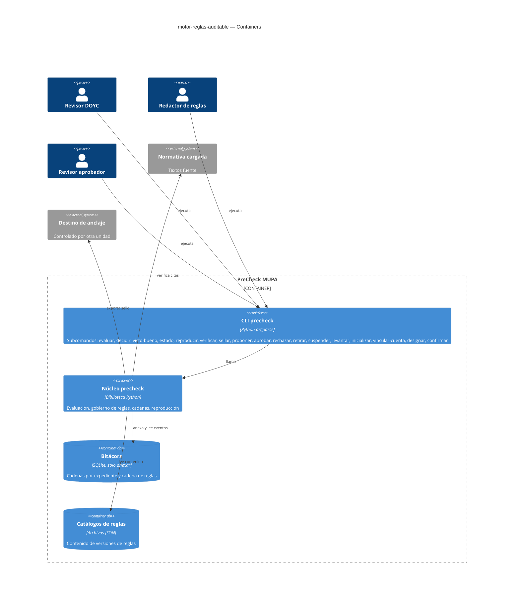

## 6. Runtime view

**Critical flow 1: evaluar un expediente (AC-01, AC-02, AC-05, AC-06, AC-21)**

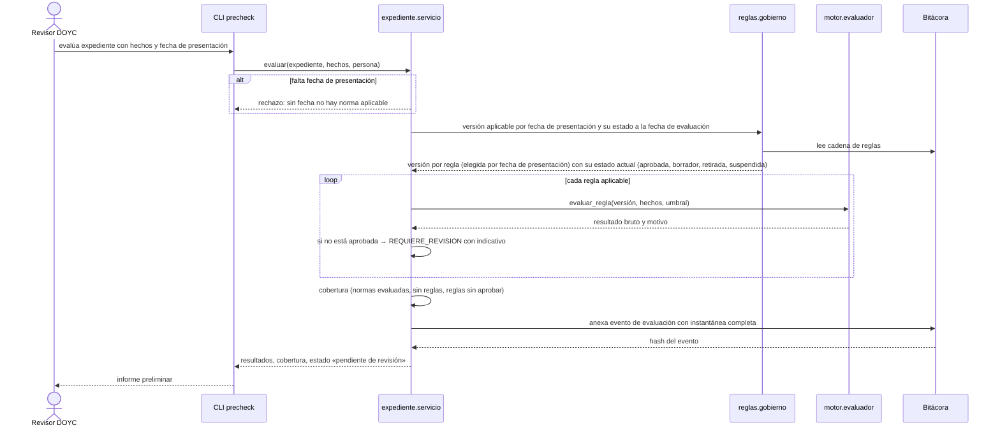

**Critical flow 2: aprobar una versión de regla con cuatro ojos (AC-09, AC-10, AC-11)**

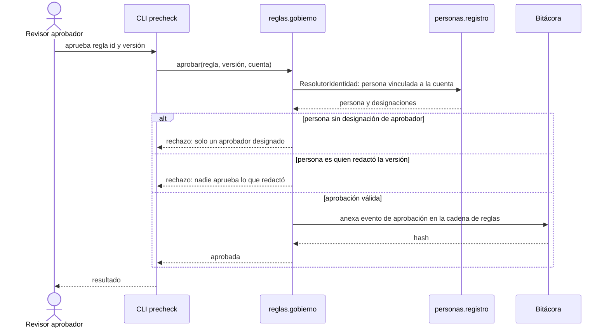

### Flujo 3: determinar la norma aplicable con CEUS (US-01 · AC-04)

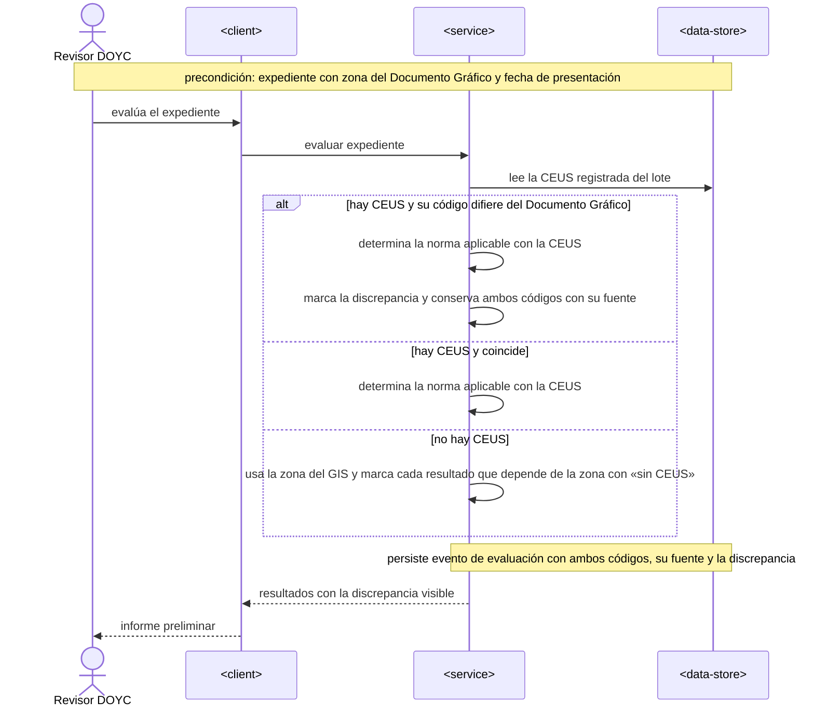

### Flujo 4: proponer una versión de regla (US-03 · AC-07, AC-08)

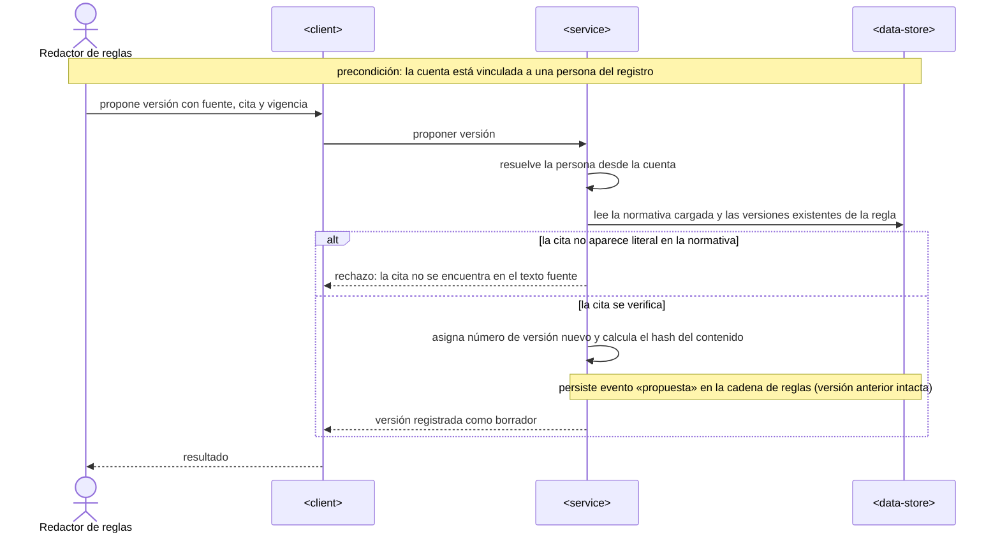

### Flujo 5: rechazar, retirar o intentar editar una versión (US-04, US-09 · AC-12, AC-20b)

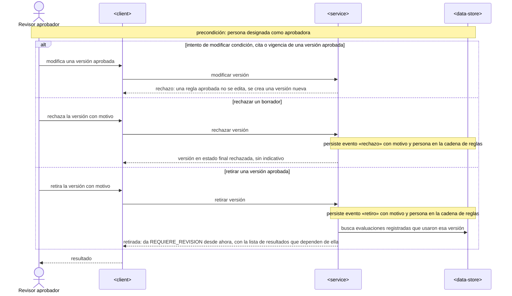

### Flujo 6: suspender una norma en bloque (US-09 · AC-20)

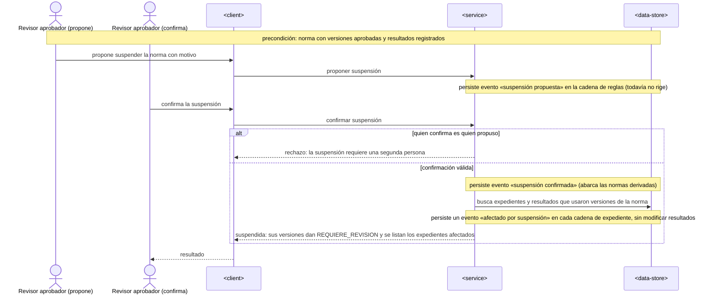

### Flujo 7: decidir sobre NO_CUMPLE bloqueante y REQUIERE_REVISION (US-05 · AC-13, AC-14)

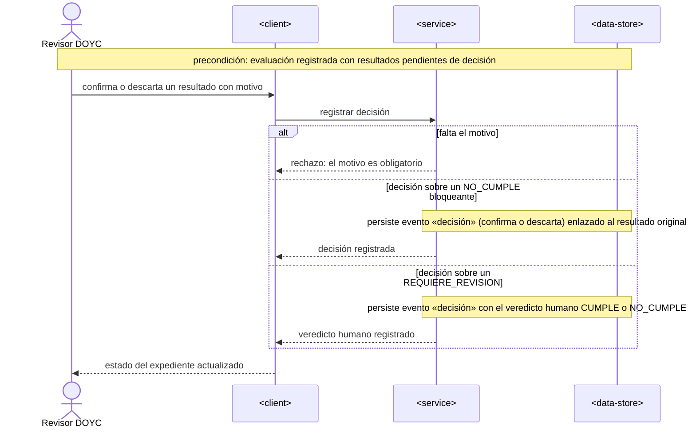

### Flujo 8: visto bueno y estado del expediente (US-06 · AC-15, AC-16)

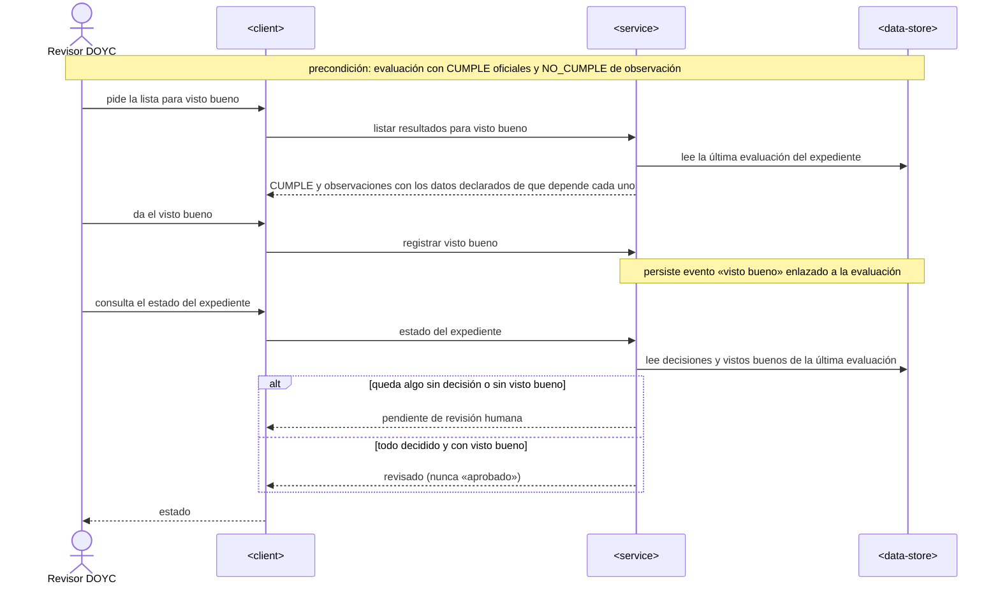

### Flujo 9: reproducir una evaluación (US-07 · AC-17, AC-18)

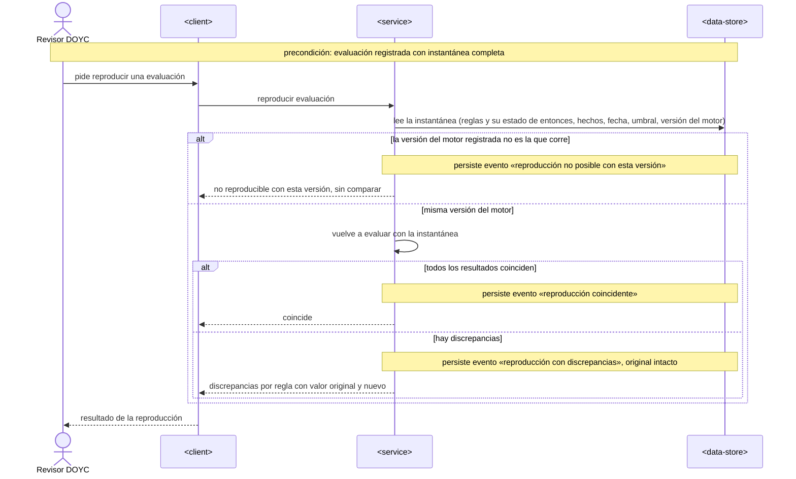

### Flujo 10: sellar y verificar la integridad (US-08 · AC-19, AC-19b)

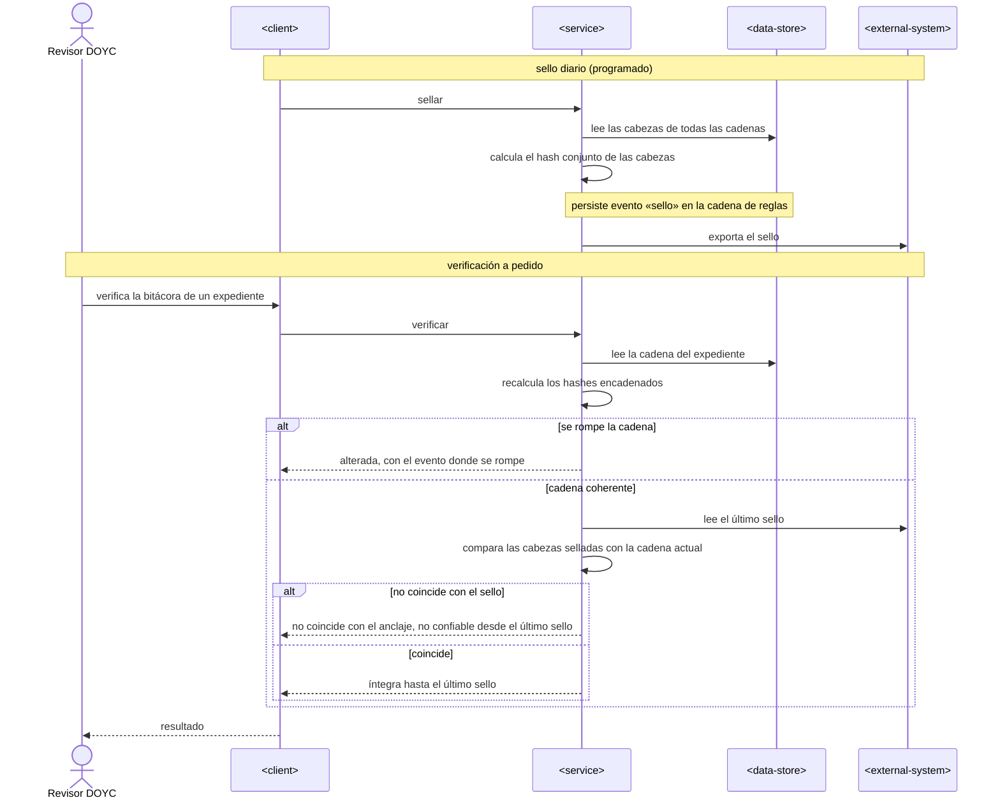

### Flujo 11: inicializar el registro de personas (spec §8 «registro de personas», ADR-0009)

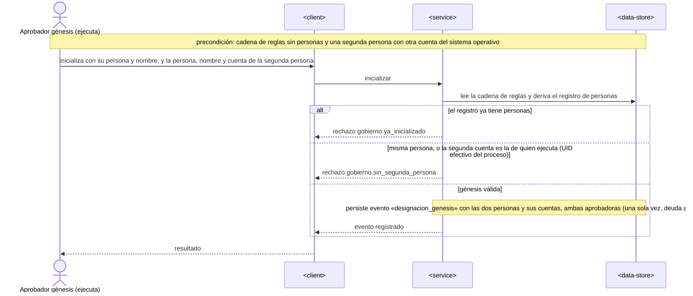

### Flujo 12: vincular una cuenta con cuatro ojos (spec §8 «registro de personas», ADR-0009)

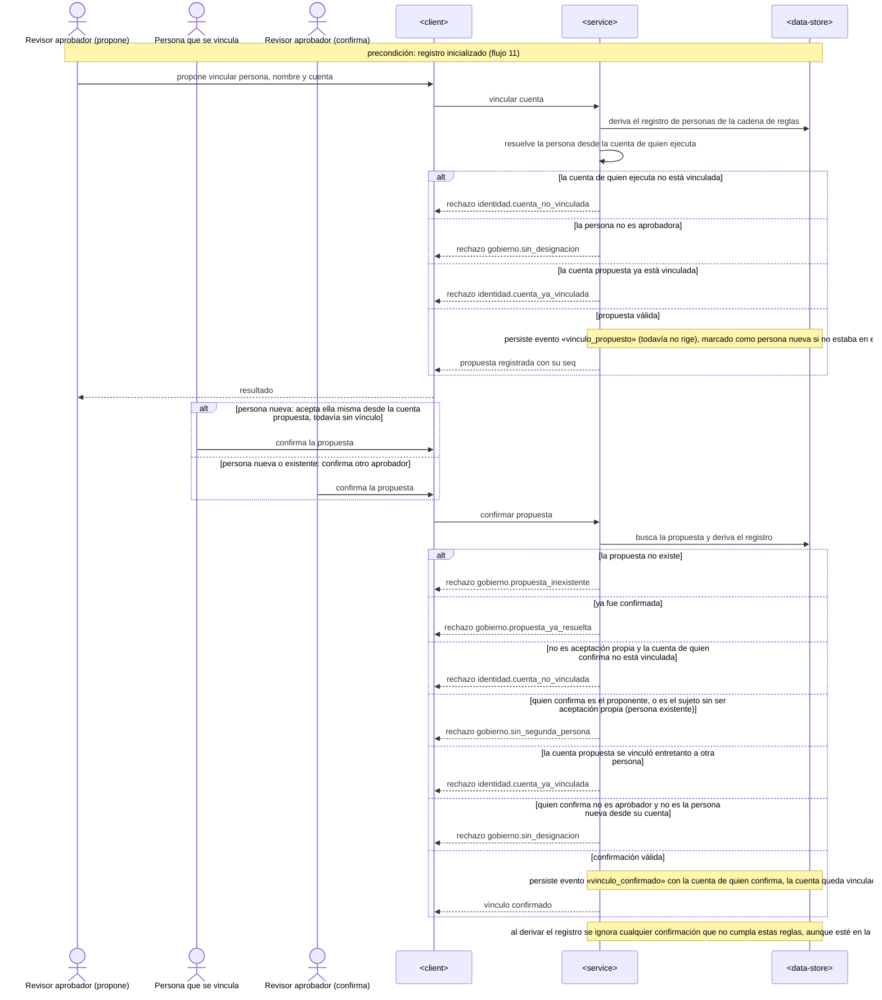

### Flujo 13: designar un rol y confirmarlo con cuatro ojos (spec §8 «registro de personas», ADR-0009)

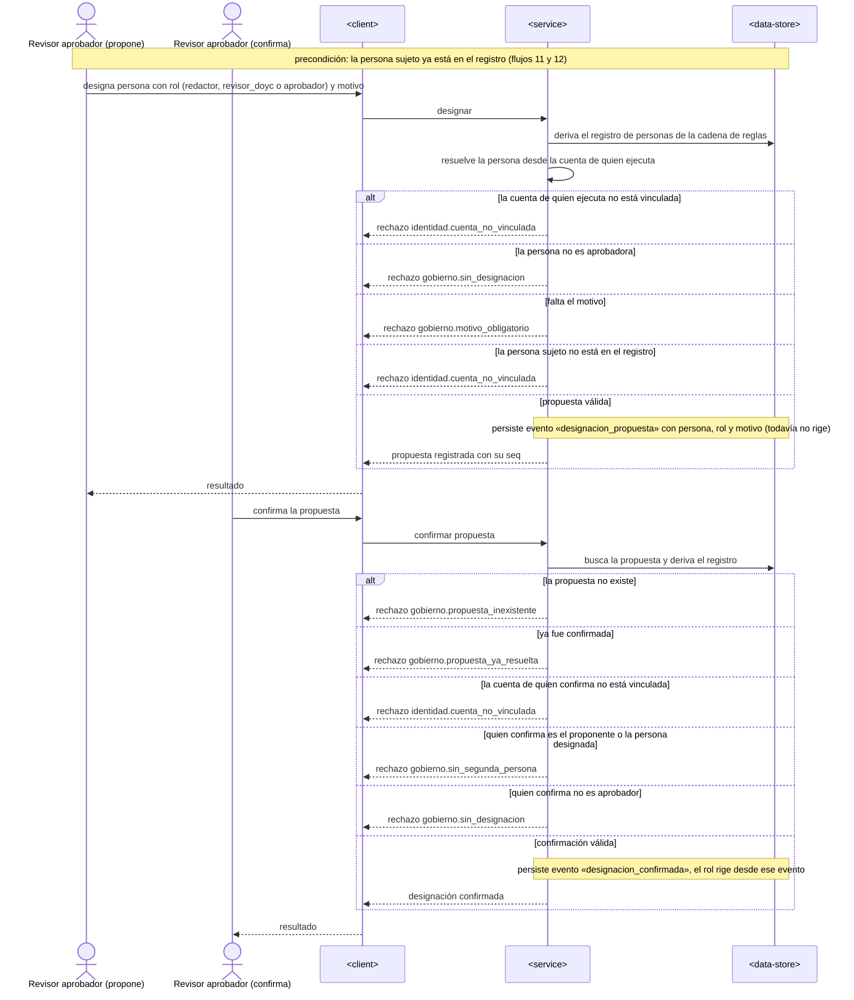

### Flujo 14: autorizar al Revisor DOYC en las operaciones de expediente (US-01, US-05, US-06, US-07 · spec §8 «autorización del Revisor DOYC»)

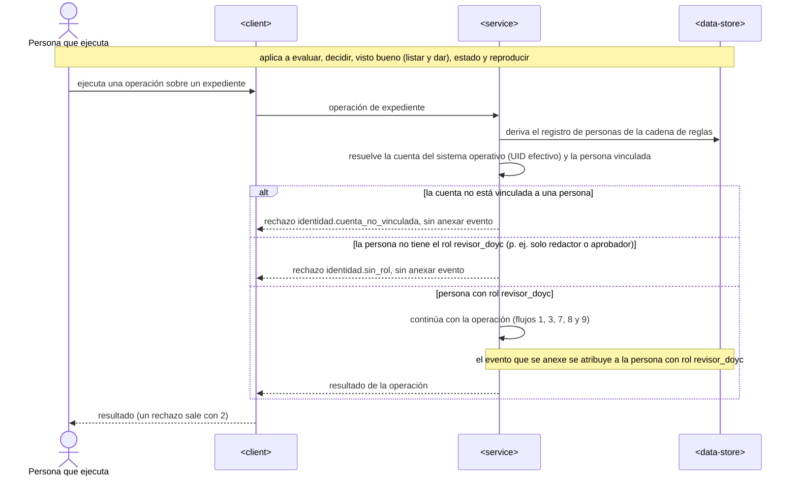

**Cobertura: historias y AC por flujo**

| Historia | Flujos | AC |
|---|---|---|
| US-01 | 1, 3 | AC-01, AC-02, AC-03, AC-05 (flujo 1); AC-04 (flujo 3) |
| US-02 | 1 | AC-06 |
| US-03 | 4 | AC-07, AC-08 |
| US-04 | 2, 5 | AC-09, AC-10, AC-11 (flujo 2); AC-12 (flujo 5) |
| US-05 | 7 | AC-13, AC-14 |
| US-06 | 8 | AC-15, AC-16 |
| US-07 | 9 | AC-17, AC-18 |
| US-08 | 10 | AC-19, AC-19b |
| US-09 | 5, 6 | AC-20b (flujo 5); AC-20 (flujo 6) |
| US-10 | 1 | AC-21 |
| US-01, US-05, US-06, US-07 (autorización del Revisor DOYC, spec §8 «autorización del Revisor DOYC») | 14 | sin AC propio |
| — (registro de personas, spec §8 «registro de personas», ADR-0009, ADR-0006) | 11, 12, 13 | sin AC propio |

**Señalado para design/data-model:** los flujos 3 y 6 necesitan leer la CEUS del lote y buscar evaluaciones por versión de regla; `data-model` debe indexar los eventos por `(regla_id, version)` y por expediente. El flujo 10 usa `<external-system>` para el destino de anclaje, que ya está declarado en §3.

## 7. Deployment view

Se ejecuta en las estaciones de la DOYC o en un servidor interno como paquete Python, sin servicios residentes. La bitácora es un archivo SQLite en un directorio con respaldo diario; el sello diario se exporta al destino de anclaje (spec §8). Hay una sola instancia de escritura por bitácora, y SQLite serializa los escritores.

**Monitoring:**
- Resultado del comando `verificar` programado a diario después del sello; si falla, se avisa al Security Lead.
- Cantidad de REQUIERE_REVISION sin decisión por expediente (insumo para el riesgo de carga del revisor).

**Scaling thresholds:**
- SQLite cómodo hasta decenas de miles de expedientes al año con instantáneas completas (aproximadamente 1 MB por evaluación con el catálogo completo). Al pasar a varios escritores concurrentes, o cuando exista la API, se migra a PostgreSQL por el puerto (ADR-0002).

## 8. Crosscutting concepts

| Concept | Convention | Where defined |
|---|---|---|
| Serialización canónica | JSON con `sort_keys`, `ensure_ascii=False`, separadores `(",", ":")`, UTF-8; los números tal como salen de `json` (repr más corto) | `precheck/auditoria/canonico.py`, heredado de `verificar_cadena.py:13` |
| Hash encadenado | `sha256(hash_previo + canónico(sobre))`, donde el sobre es `{cadena_id, tipo, actor, rol, ocurrido_en, payload}`; `hash_previo` vacío en el génesis. Cubrir el sobre impide cambiar quién hizo algo, o mover un evento a otra cadena, sin romperla; incluir `cadena_id` evita además que dos génesis idénticos choquen en el UNIQUE de `hash` | `auditoria/canonico.py` |
| Identidad | El núcleo resuelve la persona desde la cuenta con el puerto `ResolutorIdentidad`; nunca confía en una persona pasada por el llamador. Todo evento lleva `persona_id` y rol | ADR-0006 |
| Errores | Excepciones de dominio (`DatoFaltante`, `SinFechaPresentacion`, `AutoAprobacion`, `SinDesignacion`, `ReglaInmutable`, `SinSegundaPersona`) → la CLI las traduce a mensajes en español; los fallos de evaluación nunca son excepción, siempre REQUIERE_REVISION | `motor/evaluador.py`, `cli.py` |
| IDs | Reglas `<NORMA>-<TRAMITE>-<TEMA>` + versión; eventos con id secuencial por cadena + hash | esquema de reglas |
| Cuatro ojos | Aprobar una versión, suspender o levantar una norma y designar aprobadores exigen dos personas distintas: una propone y otra confirma; solo rige lo confirmado. El vínculo de una persona NUEVA lo acepta ella misma desde la cuenta propuesta (o un aprobador distinto del proponente); el vínculo de una persona existente y toda designación de rol los confirma un aprobador distinto del proponente y del sujeto. El génesis registra dos aprobadores distintos para que esto sea posible desde el inicio. El registro se deriva evento a evento e ignora confirmaciones que no cumplen estas reglas (review A2). La primera designación la registra el responsable del proyecto al instalar, como evento génesis | ADR-0006, ADR-0008 |
| Fechas | ISO 8601; fecha de presentación como fecha civil de Panamá; instantes en UTC | aquí |
| Decisión humana | Confirmar o descartar exige motivo; sobre un REQUIERE_REVISION fija un veredicto humano CUMPLE o NO_CUMPLE. Corregir un dato crea un hecho `metodo: humano` y una evaluación nueva, y el expediente vuelve a «pendiente»; las decisiones previas quedan enlazadas a la evaluación que firmaron | aquí (spec §8) |
| Reglas no aprobadas que no aplican | Si el `aplica_si` de una versión no aprobada es falso, el resultado queda NO_APLICA marcado como no oficial, no REQUIERE_REVISION: 633 de 648 reglas solo filtran por norma y zona, y mandarlas a revisión inundaría al revisor | `expediente/servicio.py` |
| Internationalisation | N/A: solo español | — |
| Versión del motor | `VERSION_MOTOR` semver + commit en cada evaluación. Reproducir solo compara si corre la misma versión registrada; si no, responde «no reproducible con esta versión» y lo registra, sin comparar | `motor/version.py` |

## 9. Architecture decisions

| # | Title | Status | Section |
|---|---|---|---|
| 0001 | Construir el núcleo como biblioteca con CLI delgada | Accepted | §4 |
| 0002 | Guardar la bitácora en SQLite de solo anexar tras un puerto | Accepted | §4 |
| 0003 | Encadenar por expediente y en una cadena de reglas | Accepted | §4 |
| 0004 | Guardar una instantánea completa en cada evaluación | Accepted | §4 |
| 0005 | Derivar el estado de las reglas de la cadena de reglas | Accepted | §4 |
| 0006 | Identificar a las personas con un registro de personas | Accepted | §4 |
| 0007 | Anclar las cabezas con un sello diario vía puerto | Accepted | §4 |
| 0008 | Suspender normas con un evento separado de la vigencia | Accepted | §4 |
| 0009 | Cuatro ojos estrictos en el registro de personas, con génesis de dos aprobadores | Accepted (enmienda 0006) | §6 flujos 11–13, §11 |
| 0010 | Calcular el hash sobre el sobre completo del evento, incluido `cadena_id` | Accepted (enmienda 0003) | §8 |
| 0011 | El NO_APLICA de una regla no aprobada filtra, pero no es oficial ni cuenta como uso | Accepted (enmienda 0005) | §6 flujo 1, §8 |

ADR files live under `docs/features/motor-reglas-auditable/adr/NNNN-<title>.md`.

## 10. Quality requirements

**QG-1. Reproducibilidad**
- **When:** un Revisor DOYC reproduce cualquier evaluación registrada sin que haya cambiado nada.
- **Then:** «100 % de resultados reproducidos coinciden con el original cuando no cambió nada».
- **How verify:** prueba automática que reproduce todas las evaluaciones del lote de validación.

**QG-2. Integridad verificable**
- **When:** se altera, inserta o elimina un evento, o se reescribe la bitácora entera.
- **Then:** «100 % de alteraciones, inserciones o eliminaciones de eventos anteriores al último anclaje externo; la ventana hasta el siguiente anclaje es un riesgo aceptado».
- **How verify:** prueba automática de manipulación de la bitácora y de reescritura completa contra el anclaje.

**QG-3. Corrección conservadora y rendimiento**
- **When:** se evalúa el lote de expedientes ya dictaminados con el catálogo completo.
- **Then:** falsos CUMPLE «0 en el lote de expedientes ya dictaminados»; tiempo «≤ 10 s por expediente con el catálogo completo (~650 reglas)»; «100 % de reglas con cita verificable antes de poder aprobarse».
- **How verify:** comparación contra el dictamen humano; medición en las pruebas con los casos de `tests/casos/`; verificación de citas en cada propuesta y en las pruebas.

## 11. Risks and technical debt

| Risk / debt | Severity | Mitigation | Owner |
|---|---|---|---|
| Sin revisor aprobador designado, todo queda en REQUIERE_REVISION | High | Designación como evento en la cadena de reglas; KPI de reglas aprobadas (spec §7) | DOYC |
| Un operador con acceso al archivo reescribe la bitácora del día en curso | Medium | Sello diario anclado fuera (ADR-0007); ventana declarada como riesgo aceptado | Security Lead |
| Crecimiento de la bitácora por las instantáneas completas | Low | Umbral de migración a PostgreSQL en §7; se puede deduplicar el contenido de reglas por hash dentro de la misma cadena | Tech Lead |
| Una versión antigua del motor deja de ser ejecutable | Medium | Versión y commit en cada evaluación; si no está disponible, «no reproducible con esta versión» en lugar de una discrepancia falsa | Tech Lead |
| Open architectural decision: cómo se conservan ejecutables las versiones antiguas del motor y por cuánto tiempo | Open question | Resolver antes de sdd:tasks (due original de spec §8: before sdd:design, movido aquí); default: mientras dure el plazo de impugnación | Tech Lead |
| Open architectural decision: quién carga la designación génesis del primer revisor aprobador | Open question | Resolver antes de sdd:tasks (due original de spec §8: before sdd:design, movido aquí); default: el responsable del proyecto, como evento génesis | DOYC |
| Se aparta de las convenciones del repo (biblioteca, SQLite, pruebas en proceso) | Low | Override documentado en §2; ADR-0001 y ADR-0002 | Tech Lead |
| Open architectural decision: destino y frecuencia del anclaje externo | Open question | Resolver antes de sdd:tasks (due original de spec §8: before sdd:design, movido aquí); default: archivo diario en un destino de otra unidad (spec §8) | Security Lead |
| Open architectural decision: comportamiento sin CEUS | Open question | Resolver antes de sdd:tasks (due original de spec §8: before sdd:design, movido aquí); default de la spec §8 | DPUOT |

**Accepted debt (acceptable in v1, plan to fix later):**
- La designación génesis de los dos primeros aprobadores no pasa por cuatro ojos: quien inicializa declara a la segunda persona y su cuenta.
- Identidad sin firma criptográfica personal: se atribuye por el registro de personas y la cuenta del SO. La firma llega con la API autenticada (ADR-0006).
- Un solo escritor por bitácora (SQLite).

## 12. Glossary

| Term | Meaning |
|---|---|
| Bitácora | Ver `CONTEXT.md` |
| Cadena de expediente | Secuencia encadenada de evaluaciones, decisiones y vistos buenos de un expediente |
| Cadena de reglas | Secuencia encadenada de propuestas, aprobaciones, rechazos, retiros, suspensiones y designaciones |
| Sello | Hash de todas las cabezas de cadena a una fecha, exportado al destino de anclaje |
| Instantánea | Contenido completo que guarda una evaluación para reproducirse: versiones de regla con su estado, hechos, fecha de presentación, umbral y versión del motor |
| Resultado indicativo | Ver `CONTEXT.md` |
| Suspensión | Evento de cuatro ojos que impide que las versiones de una norma, y de sus derivadas, emitan resultado oficial desde ese momento, sin tocar su vigencia |
