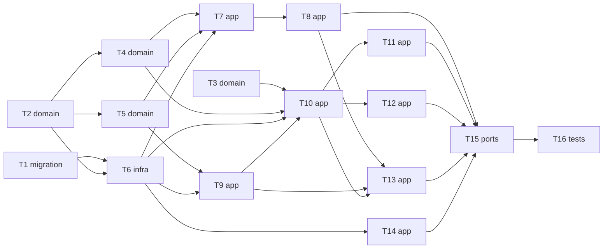

# Epic — motor-reglas-auditable

> **Spec:** [spec.md](../spec.md) · **Design:** [sad.md](../sad.md) · **Data model:** [data-model.md](../data-model.md) · **Contratos:** [cli.md](../contracts/cli.md), [public-api.md](../contracts/public-api.md) · **ADRs:** [adr/](../adr/)

## Goal

Convertir el motor en un núcleo auditable: solo las reglas aprobadas con cuatro ojos emiten resultado oficial, cada evaluación, aprobación y decisión queda en una bitácora encadenada y sellada, y cualquier resultado se puede reproducir (spec §2).

## Scope

- **In:** migración SQLite, dominio (cadena, evaluador, estado de reglas, personas), repositorio, servicios de expediente y de gobierno, sello y verificación, fachada y CLI.
- **Out:** cola de revisión con pantalla, portal ciudadano, extracción CAD/BIM/PDF, informe final (spec §3).

## Task map

## Tasks

See [tracker.md](./tracker.md) for status. Machine contract: [tasks.json](../tasks.json).

| # | Task | Layer | Blocked by | DoD (short) |
|---|---|---|---|---|
| T1 | [Promover las migraciones de la bitácora y crear su aplicador](./promover-migraciones-y-aplicador.md) | migration | — | `tests/test_migraciones.py` pasa: aplicar, reaplicar, triggers y reversión |
| T2 | [Implementar el canónico JSON y la cadena de eventos del dominio](./cadena-y-canonico.md) | domain | — | `tests/test_cadena.py` pasa, incluida la prueba de claves reordenadas |
| T3 | [Extraer el evaluador puro de motor.py y fijar VERSION_MOTOR](./evaluador-puro-y-version-motor.md) | domain | — | Las 10 pruebas existentes pasan sin cambios |
| T4 | [Derivar el estado de las reglas y seleccionar la versión aplicable](./estado-de-reglas-y-seleccion.md) | domain | T2 | `tests/test_seleccion.py` cubre AC-02, AC-06 y AC-12 y pasa |
| T5 | [Crear ErrorPreCheck y el registro de personas derivado de eventos](./errores-y-registro-de-personas.md) | domain | T2 | `tests/test_personas.py` cubre AC-10 y AC-11 (regla de dominio) y pasa |
| T6 | [Implementar RepositorioSQLite detrás del puerto de bitácora](./repositorio-sqlite.md) | infra | T1, T2 | `tests/test_sqlite_repo.py` pasa (anexar, leer, cabezas, usos, idempotencia, atomicidad) |
| T7 | [Implementar proponer versiones con verificación de cita](./proponer-versiones.md) | app | T4, T5, T6 | `tests/test_proponer.py` cubre AC-07, AC-08 y AC-12 y pasa |
| T8 | [Implementar aprobar, rechazar y retirar versiones con cuatro ojos](./aprobar-rechazar-retirar.md) | app | T7 | `tests/test_gobierno.py` cubre AC-09, AC-10, AC-11 y AC-20b y pasa |
| T9 | [Implementar inicializar, vincular cuenta, designar y confirmar propuestas](./personas-inicializar-vincular-designar.md) | app | T5, T6 | `tests/test_personas_servicio.py` pasa, incluido AC-11 de punta a punta con personas reales del registro |
| T10 | [Implementar evaluar expediente con degradación, CEUS, cobertura e instantánea](./evaluar-expediente.md) | app | T3, T4, T6, T9 | `tests/test_evaluar.py` cubre AC-01 a AC-06 y AC-21 y pasa |
| T11 | [Implementar decidir, visto bueno y estado del expediente](./decidir-visto-bueno-estado.md) | app | T10 | `tests/test_decisiones.py` cubre AC-13 a AC-16 y pasa |
| T12 | [Implementar reproducir una evaluación registrada](./reproducir-evaluacion.md) | app | T10 | `tests/test_reproducir.py` cubre AC-17 y AC-18 y pasa |
| T13 | [Implementar suspender y levantar normas con cuatro ojos](./suspender-y-levantar-normas.md) | app | T8, T9, T10 | `tests/test_suspension.py` cubre AC-20 y pasa |
| T14 | [Implementar sellar y verificar contra el anclaje externo](./sellar-y-verificar.md) | app | T6 | `tests/test_sello.py` cubre AC-19 y AC-19b y pasa |
| T15 | [Exponer la fachada PreCheck y la CLI python3 -m precheck](./fachada-y-cli.md) | ports | T8, T11, T12, T13, T14 | `tests/test_cli.py` pasa (AC-03, AC-14 y AC-16 vistos desde la CLI) |
| T16 | [Agregar la prueba de extremo a extremo y las de NFR](./pruebas-extremo-a-extremo-y-nfr.md) | tests | T15 | `tests/test_extremo_a_extremo.py` pasa: 100 % reproducciones coinciden, alteraciones detectadas, ≤ 10 s por expediente |

## Risks / Hard rules

- Ningún resultado oficial sale de una regla no aprobada, y ningún expediente queda como revisado sin que un revisor DOYC haya firmado cada resultado bloqueante y dado su visto bueno al resto; el expediente nunca se presenta como aprobado, porque el dictamen es de la DOYC. — `spec.md §2`
- Principio 1: ninguna regla emite resultado sin cita literal verificable — `CLAUDE.md`
- La bitácora nunca se modifica ni se borra; toda corrección es un evento nuevo — ADR-0002
- Preguntas abiertas con due «before sdd:tasks» que siguen abiertas (autorización del revisor, registro de personas, anclaje, CEUS, retención del motor): las tareas usan sus defaults — `spec.md §8`, `sad.md §11`
